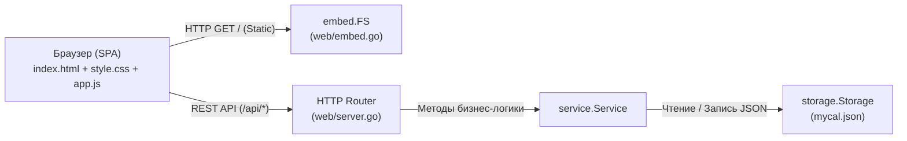

# Устройство и архитектура веб-интерфейса MyCal

Веб-интерфейс **MyCal Web** — это автономная, реактивная одностраничная панель управления (SPA), работающая локально прямо из бинарника `mycal`. Интерфейс построен по принципу **Zero-Dependency** (чистый Go на сервере, ванильный ES6+ JavaScript, чистый CSS3 и семантический HTML5 без внешних библиотек, сборщиков Webpack/Vite или node_modules).

---

## Содержание

1. [Общая архитектура и концепция](#1-общая-архитектура-и-концепция)
2. [Файловая структура проекта](#2-файловая-структура-проекта)
3. [Backend: Сервер и спецификация REST API](#3-backend-сервер-и-спецификация-rest-api)
4. [Frontend: Разметка и структура страниц (`index.html`)](#4-frontend-разметка-и-структура-страниц-indexhtml)
5. [Frontend: Стили и дизайн-система (`style.css`)](#5-frontend-стили-и-дизайн-система-stylecss)
6. [Frontend: Клиентская логика и состояние (`app.js`)](#6-frontend-клиентская-логика-и-состояние-appjs)
7. [Горячие клавиши (Keyboard Navigation)](#7-горячие-клавиши-keyboard-navigation)
8. [Руководство по самостоятельному ручному редактированию](#8-руководство-по-самостоятельному-ручному-редактированию)
9. [Сборка, верификация и синхронизация](#9-сборка-верификация-и-синхронизация)

---

## 1. Общая архитектура и концепция



### Ключевые принципы:
- **Встроенные ресурсы (Go `//go:embed`)**: все HTML, CSS и JS файлы компилируются непосредственно в бинарник программы. Пользователю не требуется носить с собой папку `web/static`.
- **Локальный REST API**: браузер общается с Go-сервером через легковесный JSON API.
- **Двусторонняя реактивность**: любые действия в интерфейсе мгновенно сохраняются через API в единое хранилище `storage.Storage`. Изменения моментально отражаются в CLI и TUI версиях.

---

## 2. Файловая структура проекта

```
web/
├── embed.go            # Встраивание статики через embed.FS
├── server.go           # HTTP-сервер, REST API эндпоинты, middleware
├── server_test.go      # Автоматические тесты API эндпоинтов
├── README.md           # Эта документация
└── static/
    ├── index.html      # Каркас SPA, разметка панелей, диалоги <dialog>
    ├── style.css       # Дизайн-система, переменные тем, адаптивная сетка
    └── app.js          # Реактивное клиентское состояние, рендеринг, API
```

---

## 3. Backend: Сервер и спецификация REST API

HTTP-сервер инициализируется в `web/server.go` вызовом `NewServer(svc, cfg, cfgPath, version)`. Маршрутизация построена на стандартном `http.NewServeMux()` Go.

### Таблица маршрутов API:

| Маршрут | Методы | Назначение |
|---|---|---|
| `/` | `GET` | Раздача статических файлов интерфейса (`embed.FS`) |
| `/api/sessions` | `GET` | Получение списка записей с фильтрацией |
| `/api/sessions` | `POST` | Создание новой записи |
| `/api/sessions/` | `GET`, `PUT`, `DELETE` | Получение, обновление или удаление записи по `ID` |
| `/api/sessions/batch` | `POST` | Пакетные операции (массовое удаление, смена статуса) |
| `/api/sessions/move` | `POST` | Перенос записей на другую дату |
| `/api/undo` | `POST` | Отмена последней операции (Undo) |
| `/api/types` | `GET`, `POST`, `DELETE` | Управление категориями/типами занятий |
| `/api/statuses` | `GET`, `POST` | Управление списком статусов записей |
| `/api/stats` | `GET` | Расчет суммарной аналитики за диапазон дат |
| `/api/calendars` | `GET`, `POST` | Управление профилями календарей |
| `/api/config` | `GET`, `POST` | Чтение и сохранение настроек интерфейса |
| `/api/export` | `GET` | Экспорт в CSV файл |
| `/api/import` | `POST` | Импорт записей из CSV файла |
| `/api/info` | `GET` | Информация о версии, пути к файлу и текущем профиле |

### Параметры фильтрации `GET /api/sessions`:
- `period` — пресет периода: `today`, `week`, `month`, `year`, `all`, `range`.
- `date` — дата для пресета `today`/`day` в формате `YYYY-MM-DD`.
- `start` / `end` — границы диапазона дат при `period=range`.
- `type` — фильтрация по конкретному типу (или список через запятую).
- `search` — поисковая строка по имени, заметкам или типу.
- `sort` — поле сортировки (`date`, `time`, `name`, `type`, `duration`, `cash`, `status`).
- `asc` — порядок: `1` (по возрастанию) или `0` (по убыванию).
- `page` / `limit` — постраничная навигация (по умолчанию `limit=0` — все).

---

## 4. Frontend: Разметка и структура страниц (`index.html`)

Документ разбит на три фундаментальные области:
1. **Верхний колонтитул (`.top-header`)**
2. **Рабочее пространство (`.main-workspace`)**
3. **Модальные диалоги (`<dialog>`) и контекстные элементы**

### 4.1. Верхний колонтитул (`.top-header`)
- **Логотип & переключатель календаря (`.brand-block`, `.calendar-switch-wrap`)**:
  - Селектор `.calendar-select` для мгновенной смены рабочего календаря.
  - Кнопка `.btn-new-cal` (`+ Новый`) для создания нового файла/профиля.
- **Табы периодов (`.period-tabs`)**: кнопки быстрого переключения временных интервалов (`Сегодня`, `Неделя`, `Месяц`, `Год`, `Все`, `Период...`).
- **Блок инструментов справа (`.header-actions`)**:
  - Строка поиска `#searchInput` с кнопкой сброса.
  - Селектор цветовой темы `#themeSelect`.
  - Кнопка вызова настроек `#btnSettings`.
  - Кнопка добавления записи `#btnNewSession` (`+ Запись`).

### 4.2. Трёхколоночный макет (`.main-workspace`)
На экранах шире `900px` рабочая область представляет собой Grid:
`grid-template-columns: 240px minmax(0, 1fr) 305px;`

#### Колонка 1: Левая панель (`.sidebar-panel`, 240px)
- **Мини-календарь (`.mini-calendar`)**:
  - Шапка навигации `.cal-nav`: кнопки смены месяца `◀ / ▶`, текущий месяц и год, быстрая кнопка перехода в «Сегодня» и «Год».
  - Сетка с номерами недель `.cal-grid-with-weeks`:
    - Кнопки номеров недель `.cal-week-btn` (формат `Н44`, выделение недели по клику).
    - Ячейки дней `.cal-day-cell`: пропорция `aspect-ratio: 1` (квадратные плитки 23×23px), поддержка состояний `.today`, `.selected`, `.range-selected`, `.other-month`.
    - Точка наличия событий `.cal-day-cell.has-events::after` (оранжевая точка внизу ячейки).
- **Фильтр типов (`.types-filter-list`)**:
  - Список категорий с бейджами и подсчетом отработанных часов.
  - Кнопка включения/выключения фильтра по клику.

#### Колонка 2: Центральная лента (`.feed-panel`, 1fr)
- **Шапка ленты (`.feed-header`)**:
  - Название текущего диапазона и счетчик записей.
  - Кнопки управления: `Отменить (Undo)`, `Выбрать все (мультивыбор)`, `Экспорт CSV`, `Импорт`, `Обновить`.
  - Селектор пагинации `10 / 25 / 50 / 100 / Все`.
- **Шапка таблицы (`.feed-table-header`)**:
  - Колонки с возможностью кликабельной сортировки: Чекбокс, Курсор, Дата, Время, Наименование, Категория, Длительность, Кэш, Статус, Действия (`···`).
- **Скролл-контейнер ленты (`.session-feed-scroll`)**:
  - Заголовки дней `.date-header`: группируют записи по датам, содержат суммарное время и количество записей за день.
  - Строка записи `.session-row`: компактная строка без лишнего вертикального паддинга (`padding: 0 14px;`), высота строки формируется контентом, обеспечивая максимальную информационную плотность.
  - Элементы строки: `.row-check-label`, `.row-cursor`, `.row-date`, `.row-time`, `.row-name`, `.row-type`, `.row-duration`, `.row-cash`, `.status-pill`, `.row-more-btn`.

#### Колонка 3: Правая панель (`.inspector-panel`, 305px, `padding: 4px;`)
- **Блок «Детали записи» (`#inspectorBox`)**:
  - Текстовый заголовок и панель быстрых действий (кнопка редактирования, дублирования, смены типа, корзина).
  - Информационные строки: `ИД`, `Дата`, `Время`, `Название`, `Тип`, `Длительность`, `Кэш`, `Статус`, `Повтор`, `Комментарий`.
  - Все поля кликабельны для быстрого редактирования по месту (inline-edit).
- **Блок «Статистика» (`#statsBox`)**:
  - Итоговые часы за период, суммарный доход (кэш), средняя длительность сессии, разбивка часов по категориям.

### 4.3. Мобильный режим (< 768px)
- Трёхколоночный макет трансформируется в одноэкранный с переключением табов.
- Нижняя панель навигации `.mobile-bottom-nav` с иконками:
  - 📋 **Записи (`feed`)**
  - 📅 **Календарь (`calendar`)**
  - 📊 **Инфо / Статистика (`stats`)**
- Плавающая кнопка `.mobile-fab` в правом нижнем углу для быстрого создания записи на ходу.
- Строка `.session-row` перестраивается в двухстрочную сетку `grid-template-areas: "check time name status more" "check meta meta meta more"`.

---

## 5. Frontend: Стили и дизайн-система (`style.css`)

Все параметры внешнего вида централизованы в CSS-переменных блока `:root` и темах `[data-theme="..."]`.

### Основные переменные:
```css
:root {
  /* Палитра интерфейса */
  --bg-app: #0f141c;          /* Фон страницы */
  --bg-surface: #161d27;      /* Фон карточек и выпадающих меню */
  --bg-panel: #1b2330;        /* Фон панелей */
  --bg-panel-alt: #131923;    /* Второстепенный фон боковых колонок */
  --bg-highlight: #242f40;    /* Подсветка при наведении */
  --bg-selection: #2a3c5a;    /* Цвет выделенной строки */

  /* Границы */
  --border-dim: #232f3e;
  --border-mid: #33445c;
  --border-focus: #60a5fa;

  /* Текст */
  --text-main: #f1f5f9;
  --text-muted: #94a3b8;
  --text-dim: #64748b;

  /* Акцентные цвета */
  --accent-blue: #60a5fa;
  --accent-cyan: #38bdf8;
  --accent-green: #4ade80;
  --accent-yellow: #facc15;
  --accent-orange: #fb923c;
  --accent-magenta: #c084fc;
  --accent-red: #f87171;

  /* Шрифты */
  --font-sans: system-ui, -apple-system, sans-serif;
  --font-mono: "JetBrains Mono", monospace;

  /* Скругления */
  --radius-sm: 4px;
  --radius-md: 8px;
  --radius-lg: 12px;
}
```

### Поддерживаемые темы:
- `tokyo` (Tokyo Night, по умолчанию — контрастная графитовая палитра)
- `catppuccin` (Catppuccin Mocha — мягкая пастельная палитра)
- `nord` (Nord Frost — холодные арктические серо-стальные оттенки)
- `dracula` (Dracula — глубокая фиолетово-неоновая тема)
- `monokai` (Monokai Pro — матовая темная тема с радужными акцентами)
- `solarized` (Solarized Dark — классическая циан-изумрудная палитра)
- `cyberpunk` (Cyberpunk Neon — сверхконтрастная неоновая желто-бирюзовая тема)
- `matrix` (Matrix Emerald — ностальгическая изумрудно-зеленая терминальная тема)
- `paper` (Paper Light — чистая, мягкая светлая тема для работы при ярком освещении)

---

## 6. Frontend: Клиентская логика и состояние (`app.js`)

Логика клиента построена на едином объекте состояния `state`.

### 6.1. Глобальный объект `state`
```javascript
const state = {
  sessions: [],             // Массив текущих загруженных сессий
  focusedId: null,          // ID выбранной записи (отображается в Инспекторе)
  selectedBatchIds: new Set(), // Набор ID для пакетных операций
  currentPeriod: "month",   // "today", "week", "month", "year", "all", "range"
  selectedDate: null,       // Выбранная дата (ISO YYYY-MM-DD)
  rangeStart: null,         // Начало диапазона дат
  rangeEnd: null,           // Конец диапазона дат
  calYear: 2026,            // Отображаемый год в мини-календаре
  calMonth: 10,             // Отображаемый месяц (0-11)
  sortField: "date",        // Поле сортировки ленты
  sortAsc: true,            // Направление сортировки
  activeTypeFilters: new Set(), // Активные фильтры по категориям
  types: [],                // Справочник типов
  statuses: [],             // Справочник статусов
  effectiveConfig: {},      // Эффективная конфигурация текущего календаря
  calendarSettings: null,   // Персональные переопределения активного календаря
  defaultVisibleFields: "", // Эталонный список всех доступных полей
  activeSettingsTab: "global", // Активная вкладка модального окна настроек
  mobileTab: "feed"         // Активный мобильный таб
};
```

### 6.2. Жизненный цикл и инициализация
1. При старте срабатывает `initApp()`:
   - Загружаются справочники: `fetchTypes()`, `fetchStatuses()`, `fetchConfig()`.
   - Инициализируются даты (текущий год, месяц, день).
   - Вызывается `loadSessions()` — отправка GET-запроса с текущими фильтрами к `/api/sessions`.
2. Функция `renderAll()` каскадно запускает:
   - `renderFeed()` — перерисовка центральной таблицы.
   - `renderMiniCalendar()` — перерисовка календаря слева.
   - `renderInspector()` — обновление деталей в правой колонке.
   - `renderStats()` — пересчет аналитики.
   - `renderTypeFilters()` — обновление счетчиков по типам.

---

## 7. Горячие клавиши (Keyboard Navigation)

Интерфейс полноценно поддерживает управление с клавиатуры без использования мыши:

| Клавиша | Действие |
|---|---|
| `j` / `↓` | Перемещение курсора к следующей записи в ленте |
| `k` / `↑` | Перемещение курсора к предыдущей записи в ленте |
| `n` / `+` | Открыть диалог создания новой записи |
| `Enter` / `e` | Редактировать выделенную запись |
| `Delete` / `Backspace` | Удалить выделенную запись (с подтверждением) |
| `Space` | Отметить чекбокс для пакетной операции |
| `d` | Быстрое дублирование выделенной записи |
| `s` | Быстрое циклическое переключение статуса записи |
| `/` | Сфокусироваться в поле глобального поиска |
| `z` / `Ctrl+Z` | Отменить последнее действие (Undo) |
| `Esc` | Закрыть модальное окно / контекстное меню / сбросить выбор |
| `?` | Показать окно со справкой по горячим клавишам |

---

## 8. Руководство по самостоятельному ручному редактированию

Ниже приведены практические рецепты для типичных задач кастомизации.

### 8.1. Как изменить ширину колонок или отступы панелей
Все пропорции колонок задаются в [style.css](file:///home/virusfun/Project/MyCal/web/static/style.css):
- **Сетка десктопа**: селектор `.main-workspace` (строка ~454):
  ```css
  .main-workspace {
    grid-template-columns: 240px minmax(0, 1fr) 305px; /* Левая | Центр | Правая */
  }
  ```
- **Отступы правой панели**: `.inspector-panel` (строка ~1006):
  ```css
  .inspector-panel {
    padding: 4px; /* Компактный отступ от границ окна */
    gap: 16px;    /* Расстояние между блоками Детали и Статистика */
  }
  ```
- **Отступы строк записей**: `.session-row` (строка ~809):
  ```css
  .session-row {
    padding: 0 14px; /* 0px сверху/снизу, 14px по бокам для выравнивания с шапкой */
  }
  ```

### 8.2. Как настроить отображение ячеек календаря
- Размеры и пропорции ячеек дня регулируются классом `.cal-day-cell` в [style.css](file:///home/virusfun/Project/MyCal/web/static/style.css):
  ```css
  .cal-day-cell {
    aspect-ratio: 1;    /* Строгий квадрат */
    min-height: 20px;
    line-height: 1;     /* Вертикальное центрирование цифры */
  }
  ```
- Оранжевая точка события: `.cal-day-cell.has-events::after` — регулируйте `bottom`, `width`, `height`.

### 8.3. Как добавить новую цветовую тему
1. В [style.css](file:///home/virusfun/Project/MyCal/web/static/style.css) добавьте новый блок:
   ```css
   [data-theme="solarized"] {
     --bg-app: #002b36;
     --bg-surface: #073642;
     --bg-panel: #073642;
     --text-main: #fdf6e3;
     --accent-blue: #268bd2;
     /* остальные переменные... */
   }
   ```
2. В [index.html](file:///home/virusfun/Project/MyCal/web/static/index.html) добавьте `<option>` в `#themeSelect`:
   ```html
   <option value="solarized">Solarized Dark</option>
   ```

### 8.4. Как добавить новое поле в форму записи
1. В [index.html](file:///home/virusfun/Project/MyCal/web/static/index.html) в форму `#sessionForm` добавить элемент ввода (например, `#sessionLocation`).
2. В [app.js](file:///home/virusfun/Project/MyCal/web/static/app.js):
   - В `openNewSessionModal()` очистить поле: `document.getElementById("sessionLocation").value = "";`
   - В `openEditSessionModal(s)` заполнить значение: `document.getElementById("sessionLocation").value = s.location || "";`
   - В `saveSessionModal()` добавить свойство в JSON отправки:
     ```javascript
     const payload = {
       ...
       location: document.getElementById("sessionLocation").value.trim()
     };
     ```
3. В структуре Go `models.Session` убедиться, что поле поддержано для сохранения в JSON.

### 8.5. Персональные настройки календарей и видимость полей (`visible_fields`)
1. Каждый календарь записей (`mycal.json`, `mycal--<key>.json`) может содержать персональный блок `"settings"`:
   ```json
   {
     "settings": {
       "visible_fields": "Дата; Наименование; Заметка",
       "theme": "nord",
       "default_duration": 0
     },
     "sessions": [ ... ]
   }
   ```
2. Параметры из блока `"settings"` календаря автоматически перекрывают глобальные настройки из `config_mycal.json`.
3. Скрытые поля:
   - Автоматически исключаются из сетки ленты (`--feed-grid-template`) и заголовков таблицы.
   - Скрываются из инспектора карточки записи и аналитики.
   - Скрываются из формы добавления и редактирования записи.
   - Не запрашиваются при добавлении записей в CLI (`mycal add`).

---

## 9. Сборка, верификация и синхронизация

> [!IMPORTANT]
> Поскольку файлы из папки `web/static/` встроены в бинарник через директиву `//go:embed`, **любые изменения HTML, CSS или JS требуют обязательной перекомпиляции программы**. В противном случае запущенный сервер продолжит отдавать старую версию интерфейса из памяти бинарника.

### Шаги для проверки и сборки:

1. **Локальный запуск для быстрой проверки**:
   ```bash
   go run . web --port 8089
   ```
   Откройте в браузере: `http://127.0.0.1:8089`.

2. **Запуск автоматических тестов (обязательно)**:
   ```bash
   go test ./...
   ```

3. **Сборка релизных бинарников и синхронизация в `~/Sync/myCal`** (согласно правилам проекта `AGENTS.md`):
   ```bash
   # Linux x86-64
   CGO_ENABLED=0 GOOS=linux GOARCH=amd64 go build -trimpath -ldflags "-s -w -X main.version=v2.13.0" -o ~/Sync/myCal/mycal .

   # Linux ARM64
   CGO_ENABLED=0 GOOS=linux GOARCH=arm64 go build -trimpath -ldflags "-s -w -X main.version=v2.13.0" -o ~/Sync/myCal/mycala .

   # Windows x86-64
   CGO_ENABLED=0 GOOS=windows GOARCH=amd64 go build -trimpath -ldflags "-s -w -X main.version=v2.13.0" -o ~/Sync/myCal/mycal.exe .
   ```
